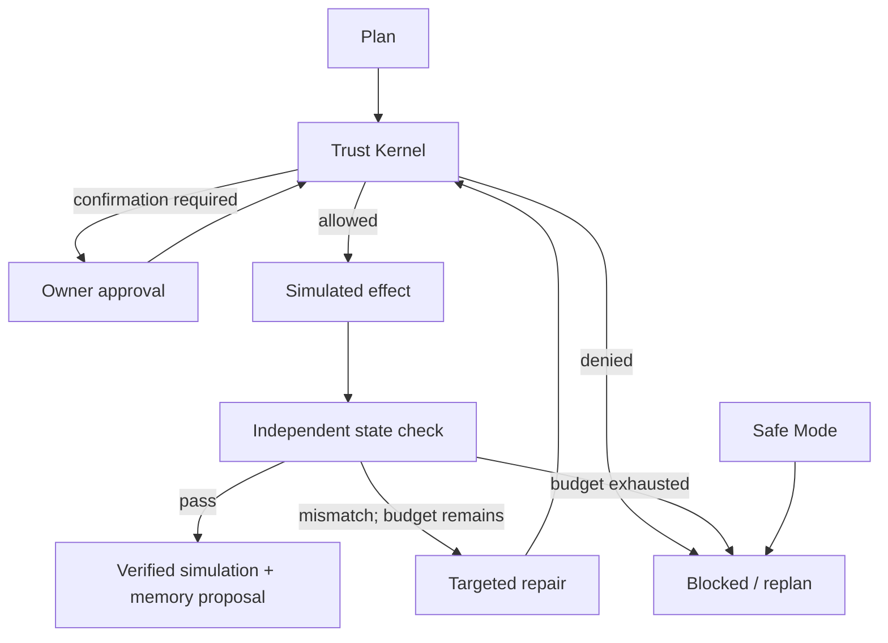

# Guardian hardened simulation contract

## Authority

Only the authenticated owner surface can create/revoke simulation grants,
confirm exact actions, resume Safe Mode or resolve memory. These endpoints are
not offered as model tools. Untrusted plans can select only a server-registered
skill and a bounded resource/value; unknown fields and unknown skills fail
closed. `production_actions_enabled` is always false and is not configurable.

A model's confidence, prompt, checker or successful previous run cannot create
authority. A0 permits scoped read/health checks. A1 prepares plans without
execution. A2 requires exact confirmation. A3 permits pre-granted bounded
simulation work. A4 accepts a schedule trigger within a matching grant, but
no production scheduler or permanent delegation is implemented.

## Grant and action binding

- Required ownership: session user + STAARWAARDD project.
- Match: connector, capability, exact resource, sensitivity, risk ceiling.
- No wildcard resource, arbitrary URL, arbitrary code or filesystem path execution.
- Grant expiry: 60 seconds to 24 hours; UI defaults to one hour.
- Action approval: exact plan hash, policy epoch, one use, maximum 60 seconds.
- Executor token: subject/run/lane/action/grant/epoch, one use, five seconds.
- Each execution and every repair passes the gate again.
- Revocation or Safe Mode invalidates cached authority.
- Red/Black operations have no registered execution skill in the MVP.

The resource is a key in a virtual per-user simulation store. It is never
interpreted as a real path. Destinations are fixed `simulation://` values;
there is no outbound network client, shell executor or device API.

## Loop lifecycle

Advance and verification are separate persisted transitions. A caller cannot
submit `completed_verified`, skip the check, or provide checker evidence.
The UI drives a short, bounded loop through explicit controls. A worker can
later drive the same transitions without gaining any additional permission.

Each plan has a server-set 60-second deadline and zero or one repair attempt.
Verification checks stored resource value/origin or an explicit read/health
criterion. An executor success message never counts as evidence.

Idempotency keys bind an exact request. Repeated keys with changed requests
are rejected. A resource-version conflict requires a fresh plan; it does not
silently merge or overwrite another lane's work. In the simulation, CAS commits
state and audit together. Future external execution requires an outbox and
provider idempotency before retryable orchestration is enabled.

## Memory and audit

Context contains only the named objective, skill/version, project, destination,
deadline and check criterion. It never includes all user history. Verified runs
create project-scoped memory proposals with source, lane, confidence, evidence,
sensitivity and expiry. Owner acceptance never promotes them into global rules.
Discard removes the proposal; access/mutation lazily purges expired proposals.
No background deletion service is claimed.

Audit events contain identifiers, decisions and timestamps; action values and
internal execution tokens are excluded. Events append through `$push` with a
previous-event hash. No public rewrite/delete endpoint exists. Hash chaining is
not protection against a database administrator who rewrites the entire chain.

## Promotion gate

Passing simulation checks is necessary but insufficient for real tools. Before
promotion: separate owner/model identities, an encrypted vault, connector
sandbox, egress allowlist, durable outbox, external idempotency, independent
provider readback, in-flight cancellation, storage limits/retention jobs and
deployment-level validation. Keep physical devices and financial operations
disabled. Do not label mocked integrations connected or operational.
